<!-- board:switch:start -->
<p align="right"><a href="https://github.com/gauranshahuja"></a> <a href="https://github.com/gauranshahuja/gauranshahuja/blob/main/BOARD.md"></a> <a href="https://github.com/gauranshahuja/gauranshahuja/blob/main/CLASSIC.md"></a></p>
<!-- board:switch:end -->

<!-- board:hero:start -->
<p align="center"></p>
<!-- board:hero:end -->

<p align="center">
  <a href="https://gauranshportfolio.web.app"></a>&nbsp;
  <a href="https://www.linkedin.com/in/gauransh-ahuja-000573261"></a>&nbsp;
  <a href="mailto:gauransh3637ahuja@gmail.com"></a>
</p>

<!-- board:summary:start -->
**15 pull requests merged upstream** in Google's Firebase CLI, AWS CDK, Internet Archive's Open Library, Sugar Labs' Music Blocks, Kubeflow Notebooks and Eclipse SW360.
<!-- board:summary:end -->

Software Developer at Nova Web Innovations, shipping full-stack JavaScript on Google Cloud Run and Firebase. MCA (AI & ML), Manipal University Jaipur, expected 2027. Based in Haridwar, India.

<p align="center"></p>

## Arrivals: code merged upstream

<!-- board:arrivals:start -->
<p align="center"></p>

<details>
<summary><b>All 15 merged pull requests</b>, with links · 6 more in review</summary>
<br>

**Open Library · Internet Archive** — 7 merged

- [#14243](https://github.com/internetarchive/openlibrary/pull/14243) Replace deprecated datetime.utcnow() and utcfromtimestamp() (ruff DTZ003, DTZ004) · <sub>5 Nov 2026</sub>
- [#13732](https://github.com/internetarchive/openlibrary/pull/13732) Lint patron\_data.sql and import-partial.sql with sqlfluff 4.4.0 · <sub>12 Oct 2026</sub>
- [#13731](https://github.com/internetarchive/openlibrary/pull/13731) Admin edit history: keep the page after a revert and add a numbered pager · <sub>1 Oct 2026</sub>
- [#13590](https://github.com/internetarchive/openlibrary/pull/13590) Convert LazyCarousel partial to Jinja · <sub>12 Sep 2026</sub>
- [#13576](https://github.com/internetarchive/openlibrary/pull/13576) Convert BookPageLists partial to Jinja · <sub>11 Sep 2026</sub>
- [#13577](https://github.com/internetarchive/openlibrary/pull/13577) Convert SearchFacets partial to Jinja · <sub>8 Sep 2026</sub>
- [#13563](https://github.com/internetarchive/openlibrary/pull/13563) Convert MyBooksDropperLists partial to Jinja · <sub>6 Sep 2026</sub>

**Firebase CLI · Google** — 3 merged

- [#11509](https://github.com/firebase/firebase-tools/pull/11509) fix(firestore): do not create a missing database on deploy --dry-run · <sub>17 Nov 2026</sub>
- [#11407](https://github.com/firebase/firebase-tools/pull/11407) fix(emulator): show the listen address next to the Emulator UI and Hub links · <sub>3 Nov 2026</sub>
- [#11042](https://github.com/firebase/firebase-tools/pull/11042) fix(emulator): warn instead of crashing when the Firestore rules watcher fails · <sub>28 Oct 2026</sub>

**Music Blocks v4 · Sugar Labs** — 2 merged

- [#906](https://github.com/sugarlabs/musicblocks-v4/pull/906) #811 | feat(masonry): measure a tower's laid-out extent · <sub>29 Sep 2026</sub>
- [#821](https://github.com/sugarlabs/musicblocks-v4/pull/821) #807 | feat(masonry): pan the canvas by dragging the background · <sub>12 Sep 2026</sub>

**AWS CDK · Amazon Web Services** — 1 merged

- [#38810](https://github.com/aws/aws-cdk/pull/38810) feat(ec2): support IPAM CIDR allocation for Subnet · <sub>16 Nov 2026</sub>

**SW360 frontend · Eclipse Foundation** — 1 merged

- [#2113](https://github.com/eclipse-sw360/sw360-frontend/pull/2113) feat(sidebar): Allow opening sidebar tabs in a new browser tab · <sub>30 Oct 2026</sub>

**Kubeflow Notebooks** — 1 merged

- [#1441](https://github.com/kubeflow/notebooks/pull/1441) improve: show secret modal errors next to the action buttons and clear them on edit · <sub>5 Oct 2026</sub>

**In review**

- [aws/aws-cdk #39752](https://github.com/aws/aws-cdk/pull/39752) feat(ec2): support IPv6 IPAM allocation for Subnet
- [internetarchive/openlibrary #14367](https://github.com/internetarchive/openlibrary/pull/14367) Summarize failed Goodreads imports and let patrons download them as CSV
- [sugarlabs/musicblocks-v4 #923](https://github.com/sugarlabs/musicblocks-v4/pull/923) #811 | feat(masonry): add cleanWorkspace to the workspace store
- [firebase/firebase-tools #11083](https://github.com/firebase/firebase-tools/pull/11083) fix(emulator): stop repeating network access warnings for a URL already reported
- [aws/aws-cdk #38814](https://github.com/aws/aws-cdk/pull/38814) feat(appsync): support adding an auth provider to an Event API after creation
- [meta/docusaurus #12431](https://github.com/meta/docusaurus/pull/12431) feat(core): resolve Markdown file links across plugins (AI-assisted)

</details>
<!-- board:arrivals:end -->

Selected work:

- **AWS CDK** · [`Subnet` allocates its IPv4 CIDR from an IPAM pool](https://github.com/aws/aws-cdk/pull/38810) through a new `ipv4IpamAllocation` property. Closes [#34296](https://github.com/aws/aws-cdk/issues/34296).
- **Firebase CLI (Google)** · [Firestore emulator warns instead of crashing](https://github.com/firebase/firebase-tools/pull/11042) when the rules watcher fails. [Startup banner prints the real listen address](https://github.com/firebase/firebase-tools/pull/11407) beside the Emulator UI and Hub links, fixing [#6222](https://github.com/firebase/firebase-tools/issues/6222).
- **Open Library (Internet Archive)** · 7 merged. [Replaced 28 deprecated `utcnow()` / `utcfromtimestamp()` calls across 16 files](https://github.com/internetarchive/openlibrary/pull/14243) and enabled ruff DTZ003/DTZ004 to keep them out. [Numbered pager on admin edit history](https://github.com/internetarchive/openlibrary/pull/13731) that keeps the page after a revert. Four template partials migrated to Jinja.
- **Music Blocks v4 (Sugar Labs)** · [Pan the canvas by dragging the background](https://github.com/sugarlabs/musicblocks-v4/pull/821), and [tower extent measurement](https://github.com/sugarlabs/musicblocks-v4/pull/906) for the workspace layout.

## Departures: products shipped

- **[ProjectHub](https://projecthub-client.web.app)** · Multi-tenant business management SaaS. Per-organisation data isolation with four-tier server-side RBAC (Owner / Admin / Manager / Member) enforced on every route. bcrypt + JWT auth, Google and GitHub login with cross-provider account linking, AES-256-GCM encrypted realtime chat over Socket.io. 23 models, 14 controllers, 200+ commits.
  <br><sub>React · Node.js · Express · MongoDB · Socket.io · Redis · Firebase · Docker · <a href="https://github.com/gauranshahuja/project-management-tool">source</a></sub>
- **ScraperPro** · Web-scraping SaaS on Google Cloud Run with Razorpay billing. 5 paying customers. Scraping API load-tested to ~5,000 concurrent requests.
  <br><sub>Node.js · Express · Cloud Run · Firebase · OpenAI · Razorpay · private repository</sub>
- **[Listify](https://listify-engine.web.app)** · Shopify catalog pipeline. Scrapes products through browser extensions, generates SEO copy, alt text and taxonomy-validated categories with Gemini, and exports import-ready CSVs.
  <br><sub>Node.js · Express · SQLite · Gemini · Cloud Run · private repository</sub>
- **[StockFlow](https://stockflow-hub.web.app)** · Multi-warehouse inventory. Batch and expiry control, FEFO dispatch, barcode and GS1 scanning, transfers, returns and analytics.
  <br><sub>React · Firestore · Three.js · <a href="https://github.com/gauranshahuja/stockflow">source</a></sub>
- **[JARVIS](https://github.com/gauranshahuja/jarvis)** · Fully offline English and Hindi voice assistant. Vosk speech recognition, OpenCV face-recognition login, realtime hand and eye tracking for cursor control. Ships as a standalone executable.
  <br><sub>Python · Vosk · OpenCV</sub>

## Stack

```text
Languages    JavaScript · TypeScript · Python · SQL
Backend      Node.js · Express · REST APIs · Socket.io · JWT · RBAC · Redis · Cloud Functions
Frontend     React · Vite · Tailwind CSS · Three.js · React Router
Data, cloud  MongoDB · Firestore · SQLite · Google Cloud Run · Firebase · Docker · GitHub Actions
Testing      Vitest · Testing Library · Mocha · ESLint · Prettier · CI/CD
AI           Google Gemini API · OpenAI API · Vosk · OpenCV
```

## Contact

Open to software engineering roles. [gauransh3637ahuja@gmail.com](mailto:gauransh3637ahuja@gmail.com) · [LinkedIn](https://www.linkedin.com/in/gauransh-ahuja-000573261) · [Portfolio](https://gauranshportfolio.web.app)

<sub>The boards on this page are SVG and CSS, no JavaScript. <a href="scripts/build-board.mjs">One script</a> rebuilds them from the GitHub API and <a href=".github/workflows/profile.yml">a workflow</a> runs it daily.</sub>
