<p align="right">Three looks: choose the one you like.</p>

<details name="look">
<summary><kbd>BOARD</kbd> view</summary>
<br>

<!-- board:hero:start -->
<p align="center"></p>
<!-- board:hero:end -->

<p align="center">
  <a href="https://gauranshportfolio.web.app"></a>&nbsp;
  <a href="https://www.linkedin.com/in/gauransh-ahuja-000573261"></a>&nbsp;
  <a href="mailto:gauransh3637ahuja@gmail.com"></a>
</p>

<!-- board:summary:start -->
**15 pull requests merged upstream** in Google's Firebase CLI, AWS CDK, Internet Archive's Open Library, Sugar Labs' Music Blocks, Kubeflow Notebooks and Eclipse SW360.
<!-- board:summary:end -->

Software Developer at Nova Web Innovations, shipping full-stack JavaScript on Google Cloud Run and Firebase. MCA (AI & ML), Manipal University Jaipur, expected 2027. Based in Haridwar, India.

<p align="center"></p>

## Arrivals: code merged upstream

<!-- board:arrivals:start -->
<p align="center"></p>

<details>
<summary><b>All 15 merged pull requests</b>, with links · 6 more in review</summary>
<br>

**Open Library · Internet Archive** — 7 merged

- [#14243](https://github.com/internetarchive/openlibrary/pull/14243) Replace deprecated datetime.utcnow() and utcfromtimestamp() (ruff DTZ003, DTZ004) · <sub>5 Nov 2026</sub>
- [#13732](https://github.com/internetarchive/openlibrary/pull/13732) Lint patron\_data.sql and import-partial.sql with sqlfluff 4.4.0 · <sub>12 Oct 2026</sub>
- [#13731](https://github.com/internetarchive/openlibrary/pull/13731) Admin edit history: keep the page after a revert and add a numbered pager · <sub>1 Oct 2026</sub>
- [#13590](https://github.com/internetarchive/openlibrary/pull/13590) Convert LazyCarousel partial to Jinja · <sub>12 Sep 2026</sub>
- [#13576](https://github.com/internetarchive/openlibrary/pull/13576) Convert BookPageLists partial to Jinja · <sub>11 Sep 2026</sub>
- [#13577](https://github.com/internetarchive/openlibrary/pull/13577) Convert SearchFacets partial to Jinja · <sub>8 Sep 2026</sub>
- [#13563](https://github.com/internetarchive/openlibrary/pull/13563) Convert MyBooksDropperLists partial to Jinja · <sub>6 Sep 2026</sub>

**Firebase CLI · Google** — 3 merged

- [#11509](https://github.com/firebase/firebase-tools/pull/11509) fix(firestore): do not create a missing database on deploy --dry-run · <sub>17 Nov 2026</sub>
- [#11407](https://github.com/firebase/firebase-tools/pull/11407) fix(emulator): show the listen address next to the Emulator UI and Hub links · <sub>3 Nov 2026</sub>
- [#11042](https://github.com/firebase/firebase-tools/pull/11042) fix(emulator): warn instead of crashing when the Firestore rules watcher fails · <sub>28 Oct 2026</sub>

**Music Blocks v4 · Sugar Labs** — 2 merged

- [#906](https://github.com/sugarlabs/musicblocks-v4/pull/906) #811 | feat(masonry): measure a tower's laid-out extent · <sub>29 Sep 2026</sub>
- [#821](https://github.com/sugarlabs/musicblocks-v4/pull/821) #807 | feat(masonry): pan the canvas by dragging the background · <sub>12 Sep 2026</sub>

**AWS CDK · Amazon Web Services** — 1 merged

- [#38810](https://github.com/aws/aws-cdk/pull/38810) feat(ec2): support IPAM CIDR allocation for Subnet · <sub>16 Nov 2026</sub>

**SW360 frontend · Eclipse Foundation** — 1 merged

- [#2113](https://github.com/eclipse-sw360/sw360-frontend/pull/2113) feat(sidebar): Allow opening sidebar tabs in a new browser tab · <sub>30 Oct 2026</sub>

**Kubeflow Notebooks** — 1 merged

- [#1441](https://github.com/kubeflow/notebooks/pull/1441) improve: show secret modal errors next to the action buttons and clear them on edit · <sub>5 Oct 2026</sub>

**In review**

- [aws/aws-cdk #39752](https://github.com/aws/aws-cdk/pull/39752) feat(ec2): support IPv6 IPAM allocation for Subnet
- [internetarchive/openlibrary #14367](https://github.com/internetarchive/openlibrary/pull/14367) Summarize failed Goodreads imports and let patrons download them as CSV · <sub>approved</sub>
- [sugarlabs/musicblocks-v4 #923](https://github.com/sugarlabs/musicblocks-v4/pull/923) #811 | feat(masonry): add cleanWorkspace to the workspace store
- [firebase/firebase-tools #11083](https://github.com/firebase/firebase-tools/pull/11083) fix(emulator): stop repeating network access warnings for a URL already reported
- [aws/aws-cdk #38814](https://github.com/aws/aws-cdk/pull/38814) feat(appsync): support adding an auth provider to an Event API after creation
- [meta/docusaurus #12431](https://github.com/meta/docusaurus/pull/12431) feat(core): resolve Markdown file links across plugins (AI-assisted)

</details>
<!-- board:arrivals:end -->

Selected work:

- **AWS CDK** · [`Subnet` allocates its IPv4 CIDR from an IPAM pool](https://github.com/aws/aws-cdk/pull/38810) through a new `ipv4IpamAllocation` property. Closes [#34296](https://github.com/aws/aws-cdk/issues/34296).
- **Firebase CLI (Google)** · [Firestore emulator warns instead of crashing](https://github.com/firebase/firebase-tools/pull/11042) when the rules watcher fails. [Startup banner prints the real listen address](https://github.com/firebase/firebase-tools/pull/11407) beside the Emulator UI and Hub links, fixing [#6222](https://github.com/firebase/firebase-tools/issues/6222).
- **Open Library (Internet Archive)** · 7 merged. [Replaced 28 deprecated `utcnow()` / `utcfromtimestamp()` calls across 16 files](https://github.com/internetarchive/openlibrary/pull/14243) and enabled ruff DTZ003/DTZ004 to keep them out. [Numbered pager on admin edit history](https://github.com/internetarchive/openlibrary/pull/13731) that keeps the page after a revert. Four template partials migrated to Jinja.
- **Music Blocks v4 (Sugar Labs)** · [Pan the canvas by dragging the background](https://github.com/sugarlabs/musicblocks-v4/pull/821), and [tower extent measurement](https://github.com/sugarlabs/musicblocks-v4/pull/906) for the workspace layout.

## Departures: products shipped

- **[ProjectHub](https://projecthub-client.web.app)** · Multi-tenant business management SaaS. Per-organisation data isolation with four-tier server-side RBAC (Owner / Admin / Manager / Member) enforced on every route. bcrypt + JWT auth, Google and GitHub login with cross-provider account linking, AES-256-GCM encrypted realtime chat over Socket.io. 23 models, 14 controllers, 200+ commits.
  <br><sub>React · Node.js · Express · MongoDB · Socket.io · Redis · Firebase · Docker · <a href="https://github.com/gauranshahuja/project-management-tool">source</a></sub>
- **ScraperPro** · Web-scraping SaaS on Google Cloud Run with Razorpay billing. 5 paying customers. Scraping API load-tested to ~5,000 concurrent requests.
  <br><sub>Node.js · Express · Cloud Run · Firebase · OpenAI · Razorpay · private repository</sub>
- **[Listify](https://listify-engine.web.app)** · Shopify catalog pipeline. Scrapes products through browser extensions, generates SEO copy, alt text and taxonomy-validated categories with Gemini, and exports import-ready CSVs.
  <br><sub>Node.js · Express · SQLite · Gemini · Cloud Run · private repository</sub>
- **[StockFlow](https://stockflow-hub.web.app)** · Multi-warehouse inventory. Batch and expiry control, FEFO dispatch, barcode and GS1 scanning, transfers, returns and analytics.
  <br><sub>React · Firestore · Three.js · <a href="https://github.com/gauranshahuja/stockflow">source</a></sub>
- **[JARVIS](https://github.com/gauranshahuja/jarvis)** · Fully offline English and Hindi voice assistant. Vosk speech recognition, OpenCV face-recognition login, realtime hand and eye tracking for cursor control. Ships as a standalone executable.
  <br><sub>Python · Vosk · OpenCV</sub>

## Stack

```text
Languages    JavaScript · TypeScript · Python · SQL
Backend      Node.js · Express · REST APIs · Socket.io · JWT · RBAC · Redis · Cloud Functions
Frontend     React · Vite · Tailwind CSS · Three.js · React Router
Data, cloud  MongoDB · Firestore · SQLite · Google Cloud Run · Firebase · Docker · GitHub Actions
Testing      Vitest · Testing Library · Mocha · ESLint · Prettier · CI/CD
AI           Google Gemini API · OpenAI API · Vosk · OpenCV
```

## Contact

Open to software engineering roles. [gauransh3637ahuja@gmail.com](mailto:gauransh3637ahuja@gmail.com) · [LinkedIn](https://www.linkedin.com/in/gauransh-ahuja-000573261) · [Portfolio](https://gauranshportfolio.web.app)

<sub>The boards on this page are SVG and CSS, no JavaScript. <a href="scripts/build-board.mjs">One script</a> rebuilds them from the GitHub API and <a href=".github/workflows/profile.yml">a workflow</a> runs it daily.</sub>

</details>

<details name="look">
<summary><kbd>CLASSIC</kbd> view</summary>
<br>

<!-- ============ HEADER ============ -->
<div align="center">

[](https://git.io/typing-svg)

<p>
  <a href="https://www.linkedin.com/in/gauransh-ahuja-000573261"></a>
  <a href="https://leetcode.com/u/GauranshAhuja/"></a>
  <a href="https://gauranshportfolio.web.app"></a>
  <a href="mailto:gauransh3637ahuja@gmail.com"></a>
</p>

</div>

---

### 👨‍💻 About me

```js
const gauransh = {
  role: "Full-Stack Developer @ Nova Web Innovations",
  stack: ["React", "Node.js", "Express", "MongoDB", "Firebase"],
  cloud: ["Google Cloud Run", "Docker", "GitHub Actions"],
  ai: ["Google Gemini", "OpenAI", "Vosk (offline)"],
  builds: ["multi-tenant SaaS", "AI cataloging pipelines",
           "inventory systems", "offline voice AI"],
  education: "BCA ✓  ·  MCA — AI/ML (in progress)",
  location: "Haridwar, India 🇮🇳",
};
```

I’m a full-stack (MERN) developer who **builds and ships real, deployed products**. My repos aren’t demos — they’re live systems people use:

- 🧩 **Multi-tenant SaaS** with server-side RBAC, JWT + social login and real-time collaboration
- 🤖 **AI-powered pipelines** that scrape products and auto-generate SEO catalogs (Gemini / OpenAI)
- 📦 **Multi-warehouse inventory** with batch/expiry control, barcode scanning and 3D visualization
- 🎙️ A **fully offline voice assistant** (English + Hindi) with biometric auth and a sci-fi HUD

I care about clean REST APIs, solid auth & role-based access control, and code that actually makes it to production — on **Google Cloud Run** and **Firebase**.

---

### 🛠️ Tech Stack


<br>


<br>


<br>


<br>


---

### 🚀 Featured Projects

<table>
<tr>
<td width="50%" valign="top">

#### 🏢 ProjectHub
**Multi-Tenant Project Management SaaS**

Each company gets an isolated workspace with invite-based onboarding via role-scoped, expiring invite links. Four-tier RBAC (Owner / Admin / Manager / Member) enforced server-side on every route. Email/password (bcrypt + JWT) plus Google & GitHub social login with cross-provider account linking. Hardened with Helmet, rate-limited auth, and a centralized error handler.

`React` `Node` `Express` `MongoDB` `JWT` `Firebase`

[🌐 Live Demo](https://projecthub-client.web.app) · [📦 Repo](https://github.com/gauranshahuja/project-management-tool)

</td>
<td width="50%" valign="top">

#### 🛍️ Shopify Listing AI
**AI-Powered Shopify Listing Generator**

Scrapes Shopify and Amazon product data and outputs ready-to-import CSVs, enriching each product with **Gemini-generated** SEO copy, image alt text, and taxonomy-validated categories. Includes a human review-gate, full run history, browser scraper extensions, and admin-invite-only auth. Deployed on Google Cloud Run.

`Node` `Express` `SQLite` `Gemini` `Cloud Run`

[🌐 Live](https://listify-engine.web.app) · [📦 Repo](https://github.com/gauranshahuja/shopify-listing-ai)

</td>
</tr>
<tr>
<td width="50%" valign="top">

#### 📦 StockFlow
**Multi-Warehouse Inventory & Order Control**

A web-based inventory + order-processing system with batch/expiry control, **FEFO dispatch**, barcode + GS1 2D scanning with OCR, warehouse transfers, returns, analytics, and live Google Sheets sync. Role- and location-scoped Firestore security rules. Includes 3D warehouse visualizations with Three.js.

`React` `Firebase` `Firestore` `Three.js` `ZXing`

[🌐 Live Demo](https://stockflow-hub.web.app) · [📦 Repo](https://github.com/gauranshahuja/stockflow)

</td>
<td width="50%" valign="top">

#### 🤖 Jarvis
**Offline Voice Assistant (English + Hindi)**

A desktop voice assistant with **fully offline** speech recognition (Vosk) in both English and Hindi — 24 voice skills, optional AI conversation, face/voice biometric auth, hand & eye tracking, Doctor-Strange-style gesture magic, and a sci-fi holographic HUD.

`Python` `Vosk` `OpenCV`

[📦 Repo](https://github.com/gauranshahuja/jarvis)

</td>
</tr>
<tr>
<td width="50%" valign="top">

#### ⚡ ScraperPro
**Live Web-Scraping SaaS (Backend)**

The Node.js + Express backend behind a **live, monetized SaaS** — Razorpay payments (orders, verification, webhooks), a scrape-job pipeline, OpenAI-powered listing generation with a credit system, an AI Listing Agent, and a server-verified owner admin API. Deployed on Google Cloud Run.

`Node` `Express` `Razorpay` `OpenAI` `Cloud Run`

[📦 Repo](https://github.com/gauranshahuja/scraperpro) · [🌐 Live](https://scraperpro.online)

</td>
<td width="50%" valign="top">

#### 🧠 LeetCode
**Data Structures & Algorithms**

Sharpening problem-solving daily — my solutions in C / C++ / Python, organized by topic and growing.

`C` `C++` `Python` `DSA`

[📦 Repo](https://github.com/gauranshahuja/leetcode-s_solutions) · [🔗 Profile](https://leetcode.com/u/GauranshAhuja/)

</td>
</tr>
</table>

> 🔭 More projects in active development — this list keeps growing.

---

### 📊 GitHub Stats

<div align="center">


</div>

### 🧠 LeetCode

<div align="center">

[](https://leetcode.com/u/GauranshAhuja/)

</div>

---

### ⚡ Recent Activity

<!--START_SECTION:activity-->
1. 🗣 Commented on [#14367](https://github.com/internetarchive/openlibrary/pull/14367#issuecomment-6990435282) in [internetarchive/openlibrary](https://github.com/internetarchive/openlibrary)
<!--END_SECTION:activity-->

---

<div align="center">

### 💬 Let’s connect

I’m open to **full-stack / software engineering opportunities**. Building things that ship.

<a href="https://gauranshportfolio.web.app"></a>
<a href="https://www.linkedin.com/in/gauransh-ahuja-000573261"></a>
<a href="https://leetcode.com/u/GauranshAhuja/"></a>
<a href="mailto:gauransh3637ahuja@gmail.com"></a>

<sub>⭐ Thanks for visiting — feel free to explore my repos!</sub>

</div>

</details>

<details name="look" open>
<summary><kbd>MOTION</kbd> view</summary>
<br>

<!-- board:hero:start -->
<p align="center"></p>
<!-- board:hero:end -->

<p align="center">
  <a href="https://gauranshportfolio.web.app"></a>&nbsp;
  <a href="https://www.linkedin.com/in/gauransh-ahuja-000573261"></a>&nbsp;
  <a href="mailto:gauransh3637ahuja@gmail.com"></a>
</p>

<!-- board:summary:start -->
**15 pull requests merged upstream** in Google's Firebase CLI, AWS CDK, Internet Archive's Open Library, Sugar Labs' Music Blocks, Kubeflow Notebooks and Eclipse SW360.
<!-- board:summary:end -->

Software Developer at Nova Web Innovations, shipping full-stack JavaScript on Google Cloud Run and Firebase. MCA (AI & ML), Manipal University Jaipur, expected 2027. Based in Haridwar, India.

<p align="center"></p>

## Merged upstream

<!-- board:log:start -->
<p align="center"></p>

<details>
<summary><b>All 15 merged pull requests</b>, with links · 6 more in review</summary>
<br>

**Open Library · Internet Archive** — 7 merged

- [#14243](https://github.com/internetarchive/openlibrary/pull/14243) Replace deprecated datetime.utcnow() and utcfromtimestamp() (ruff DTZ003, DTZ004) · <sub>5 Nov 2026</sub>
- [#13732](https://github.com/internetarchive/openlibrary/pull/13732) Lint patron\_data.sql and import-partial.sql with sqlfluff 4.4.0 · <sub>12 Oct 2026</sub>
- [#13731](https://github.com/internetarchive/openlibrary/pull/13731) Admin edit history: keep the page after a revert and add a numbered pager · <sub>1 Oct 2026</sub>
- [#13590](https://github.com/internetarchive/openlibrary/pull/13590) Convert LazyCarousel partial to Jinja · <sub>12 Sep 2026</sub>
- [#13576](https://github.com/internetarchive/openlibrary/pull/13576) Convert BookPageLists partial to Jinja · <sub>11 Sep 2026</sub>
- [#13577](https://github.com/internetarchive/openlibrary/pull/13577) Convert SearchFacets partial to Jinja · <sub>8 Sep 2026</sub>
- [#13563](https://github.com/internetarchive/openlibrary/pull/13563) Convert MyBooksDropperLists partial to Jinja · <sub>6 Sep 2026</sub>

**Firebase CLI · Google** — 3 merged

- [#11509](https://github.com/firebase/firebase-tools/pull/11509) fix(firestore): do not create a missing database on deploy --dry-run · <sub>17 Nov 2026</sub>
- [#11407](https://github.com/firebase/firebase-tools/pull/11407) fix(emulator): show the listen address next to the Emulator UI and Hub links · <sub>3 Nov 2026</sub>
- [#11042](https://github.com/firebase/firebase-tools/pull/11042) fix(emulator): warn instead of crashing when the Firestore rules watcher fails · <sub>28 Oct 2026</sub>

**Music Blocks v4 · Sugar Labs** — 2 merged

- [#906](https://github.com/sugarlabs/musicblocks-v4/pull/906) #811 | feat(masonry): measure a tower's laid-out extent · <sub>29 Sep 2026</sub>
- [#821](https://github.com/sugarlabs/musicblocks-v4/pull/821) #807 | feat(masonry): pan the canvas by dragging the background · <sub>12 Sep 2026</sub>

**AWS CDK · Amazon Web Services** — 1 merged

- [#38810](https://github.com/aws/aws-cdk/pull/38810) feat(ec2): support IPAM CIDR allocation for Subnet · <sub>16 Nov 2026</sub>

**SW360 frontend · Eclipse Foundation** — 1 merged

- [#2113](https://github.com/eclipse-sw360/sw360-frontend/pull/2113) feat(sidebar): Allow opening sidebar tabs in a new browser tab · <sub>30 Oct 2026</sub>

**Kubeflow Notebooks** — 1 merged

- [#1441](https://github.com/kubeflow/notebooks/pull/1441) improve: show secret modal errors next to the action buttons and clear them on edit · <sub>5 Oct 2026</sub>

**In review**

- [aws/aws-cdk #39752](https://github.com/aws/aws-cdk/pull/39752) feat(ec2): support IPv6 IPAM allocation for Subnet
- [internetarchive/openlibrary #14367](https://github.com/internetarchive/openlibrary/pull/14367) Summarize failed Goodreads imports and let patrons download them as CSV · <sub>approved</sub>
- [sugarlabs/musicblocks-v4 #923](https://github.com/sugarlabs/musicblocks-v4/pull/923) #811 | feat(masonry): add cleanWorkspace to the workspace store
- [firebase/firebase-tools #11083](https://github.com/firebase/firebase-tools/pull/11083) fix(emulator): stop repeating network access warnings for a URL already reported
- [aws/aws-cdk #38814](https://github.com/aws/aws-cdk/pull/38814) feat(appsync): support adding an auth provider to an Event API after creation
- [meta/docusaurus #12431](https://github.com/meta/docusaurus/pull/12431) feat(core): resolve Markdown file links across plugins (AI-assisted)

</details>
<!-- board:log:end -->

Selected work:

- **AWS CDK** · [`Subnet` allocates its IPv4 CIDR from an IPAM pool](https://github.com/aws/aws-cdk/pull/38810) through a new `ipv4IpamAllocation` property. Closes [#34296](https://github.com/aws/aws-cdk/issues/34296).
- **Firebase CLI (Google)** · [Firestore emulator warns instead of crashing](https://github.com/firebase/firebase-tools/pull/11042) when the rules watcher fails. [Startup banner prints the real listen address](https://github.com/firebase/firebase-tools/pull/11407) beside the Emulator UI and Hub links, fixing [#6222](https://github.com/firebase/firebase-tools/issues/6222).
- **Open Library (Internet Archive)** · 7 merged. [Replaced 28 deprecated `utcnow()` / `utcfromtimestamp()` calls across 16 files](https://github.com/internetarchive/openlibrary/pull/14243) and enabled ruff DTZ003/DTZ004 to keep them out. [Numbered pager on admin edit history](https://github.com/internetarchive/openlibrary/pull/13731) that keeps the page after a revert. Four template partials migrated to Jinja.
- **Music Blocks v4 (Sugar Labs)** · [Pan the canvas by dragging the background](https://github.com/sugarlabs/musicblocks-v4/pull/821), and [tower extent measurement](https://github.com/sugarlabs/musicblocks-v4/pull/906) for the workspace layout.

## Contributions

<!-- board:contrib:start -->
<p align="center"></p>

<details>
<summary><b>Day by day</b>: what each square on the chart was</summary>
<br>

<details open>
<summary>November 2026 · 18 active days · 42 contributions</summary>

| Day | Count | What |
|---|--:|---|
| Wed 18 Nov | 1 | no public details |
| Tue 17 Nov | 5 | **leetcode-s_solutions**: personal-practice: day 013 and 024 took four attempts; day 137 time b…<br>**firebase/firebase-tools**: fix(firestore): do not create a missing database on deploy --dry-run … |
| Mon 16 Nov | 14 | **leetcode-s_solutions**: day 138: Count of Smaller Numbers After Self (Hard); add month-05-november-hard-1 notes; add REVISIT.md (+6 more)<br>**gauranshahuja**: feat: split-flap profile board, with a switch to the classic profile; feat: MOTION look, a third switchable profile version; feat(motion): date the best streak and add a current-streak counter (+3 more)<br>**aws/aws-cdk**: feat(ec2): support IPAM CIDR allocation for Subnet (#38810)<br>opened issue aws/aws-cdk#39750: (aws-ec2): Support IPv6 IPAM allocation in L2 Subnet construct<br>opened PR aws/aws-cdk#39752: feat(ec2): support IPv6 IPAM allocation for Subnet |
| Sun 15 Nov | 1 | **leetcode-s_solutions**: day 137: Burst Balloons (Hard) |
| Sat 14 Nov | 1 | **leetcode-s_solutions**: day 136: Candy (Hard) |
| Fri 13 Nov | 3 | **leetcode-s_solutions**: add lib/structures.js: shared ListNode, TreeNode, PriorityQueue, DSU; day 135: Find Median from Data Stream (Hard)<br>opened PR firebase/firebase-tools#11509: fix(firestore): do not create a missing database on deploy --dry-run |
| Thu 12 Nov | 1 | **leetcode-s_solutions**: day 134: LFU Cache (Hard) |
| Wed 11 Nov | 1 | **leetcode-s_solutions**: day 133: Serialize and Deserialize Binary Tree (Hard) |
| Tue 10 Nov | 2 | **leetcode-s_solutions**: day 132: Sudoku Solver (Hard)<br>opened PR internetarchive/openlibrary#14367: Summarize failed Goodreads imports and let patrons download them as CSV |
| Mon 9 Nov | 1 | **leetcode-s_solutions**: day 131: N-Queens (Hard) |
| Sun 8 Nov | 1 | **leetcode-s_solutions**: day 130: Word Search II (Hard) |
| Sat 7 Nov | 1 | **leetcode-s_solutions**: day 129: Word Ladder (Hard) |
| Fri 6 Nov | 1 | **leetcode-s_solutions**: day 128: Wildcard Matching (Hard) |
| Thu 5 Nov | 2 | **leetcode-s_solutions**: day 127: Regular Expression Matching (Hard)<br>**internetarchive/openlibrary**: Replace deprecated datetime.utcnow() and utcfromtimestamp() (ruff DTZ… |
| Wed 4 Nov | 2 | **leetcode-s_solutions**: day 126: Edit Distance (Hard) |
| Tue 3 Nov | 1 | **leetcode-s_solutions**: day 125: Longest Valid Parentheses (Hard)<br>**firebase/firebase-tools**: fix(emulator): show the listen address next to the Emulator UI and Hu… |
| Mon 2 Nov | 1 | **leetcode-s_solutions**: day 124: Median of Two Sorted Arrays (Hard) |
| Sun 1 Nov | 3 | **leetcode-s_solutions**: day 123: Trapping Rain Water (Hard)<br>opened PR firebase/firebase-tools#11407: fix(emulator): show the listen address next to the Emulator UI and Hub links<br>opened PR internetarchive/openlibrary#14243: Replace deprecated datetime.utcnow() and utcfromtimestamp() (ruff DTZ003, DTZ004) |

</details>

<details>
<summary>October 2026 · 31 active days · 38 contributions</summary>

| Day | Count | What |
|---|--:|---|
| Sat 31 Oct | 2 | **leetcode-s_solutions**: day 122: House Robber III (Medium); add month-04-october-medium-3 notes |
| Fri 30 Oct | 1 | **leetcode-s_solutions**: day 121: Coin Change II (Medium) |
| Thu 29 Oct | 1 | **leetcode-s_solutions**: day 120: Redundant Connection (Medium) |
| Wed 28 Oct | 2 | **leetcode-s_solutions**: day 119: Network Delay Time (Medium)<br>**firebase/firebase-tools**: fix(emulator): warn instead of crashing when the Firestore rules watc… |
| Tue 27 Oct | 1 | **leetcode-s_solutions**: day 118: 01 Matrix (Medium) |
| Mon 26 Oct | 1 | **leetcode-s_solutions**: day 117: Course Schedule II (Medium) |
| Sun 25 Oct | 1 | **leetcode-s_solutions**: day 116: Reorganize String (Medium) |
| Sat 24 Oct | 1 | **leetcode-s_solutions**: day 115: Task Scheduler (Medium) |
| Fri 23 Oct | 1 | **leetcode-s_solutions**: day 114: Top K Frequent Words (Medium) |
| Thu 22 Oct | 1 | **leetcode-s_solutions**: day 113: Word Break (Medium) |
| Wed 21 Oct | 1 | **leetcode-s_solutions**: day 112: Implement Trie (Prefix Tree) (Medium) |
| Tue 20 Oct | 1 | **leetcode-s_solutions**: day 111: Vertical Order Traversal of a Binary Tree (Medium) |
| Mon 19 Oct | 1 | **leetcode-s_solutions**: day 110: Count Complete Tree Nodes (Medium) |
| Sun 18 Oct | 1 | **leetcode-s_solutions**: day 109: Binary Tree Maximum Path Sum (Hard) |
| Sat 17 Oct | 1 | **leetcode-s_solutions**: day 108: Binary Tree Zigzag Level Order Traversal (Medium) |
| Fri 16 Oct | 1 | **leetcode-s_solutions**: day 107: Restore IP Addresses (Medium) |
| Thu 15 Oct | 1 | **leetcode-s_solutions**: day 106: Combination Sum II (Medium) |
| Wed 14 Oct | 1 | **leetcode-s_solutions**: day 105: Palindrome Partitioning (Medium) |
| Tue 13 Oct | 2 | **leetcode-s_solutions**: day 104: Decode String (Medium) |
| Mon 12 Oct | 1 | **leetcode-s_solutions**: day 103: Basic Calculator II (Medium)<br>**internetarchive/openlibrary**: Lint patron_data.sql and import-partial.sql with sqlfluff 4.4.0 (#13732) |
| Sun 11 Oct | 2 | **leetcode-s_solutions**: day 102: Largest Rectangle in Histogram (Hard)<br>reviewed PR sugarlabs/musicblocks-v4#953: #931 \| fix(masonry): keep the help panel on its brick on pan and zoom |
| Sat 10 Oct | 1 | **leetcode-s_solutions**: day 101: Merge k Sorted Lists (Hard) |
| Fri 9 Oct | 1 | **leetcode-s_solutions**: day 100: Reverse Nodes in k-Group (Hard) |
| Thu 8 Oct | 1 | **leetcode-s_solutions**: day 099: Game of Life (Medium) |
| Wed 7 Oct | 3 | **leetcode-s_solutions**: day 098: Minimum Number of Days to Make m Bouquets (Medium)<br>opened PR eclipse-sw360/sw360-frontend#2113: feat(sidebar): Allow opening sidebar tabs in a new browser tab |
| Tue 6 Oct | 1 | **leetcode-s_solutions**: day 097: Find the Duplicate Number (Medium) |
| Mon 5 Oct | 2 | **leetcode-s_solutions**: day 096: 4Sum (Medium)<br>**kubeflow/notebooks**: improve: show secret modal errors next to the action buttons and clea… |
| Sun 4 Oct | 1 | **leetcode-s_solutions**: day 095: Count Number of Nice Subarrays (Medium) |
| Sat 3 Oct | 1 | **leetcode-s_solutions**: day 094: Sliding Window Maximum (Hard) |
| Fri 2 Oct | 1 | **leetcode-s_solutions**: day 093: Minimum Window Substring (Hard) |
| Thu 1 Oct | 1 | **leetcode-s_solutions**: day 092: Longest Palindromic Substring (Medium) |

</details>

<details>
<summary>September 2026 · 30 active days · 73 contributions</summary>

| Day | Count | What |
|---|--:|---|
| Wed 30 Sep | 2 | **leetcode-s_solutions**: day 091: Non-overlapping Intervals (Medium); add month-03-september-medium-2 notes |
| Tue 29 Sep | 3 | **leetcode-s_solutions**: day 090: Partition Equal Subset Sum (Medium)<br>opened PR sugarlabs/musicblocks-v4#923: #811 \| feat(masonry): add cleanWorkspace to the workspace store |
| Mon 28 Sep | 8 | **leetcode-s_solutions**: day 089: Minimum Path Sum (Medium)<br>**internetarchive/openlibrary**: Use a 303 redirect and a numbered pager in the admin edit history<br>opened PR kubeflow/notebooks#1441: improve: show secret modal errors next to the action buttons and clear them on edit<br>opened PR laurent22/joplin#16693: Desktop, Plugins: Fixes #16649: Register plugin menu commands without an accelerator in the keymap |
| Sun 27 Sep | 1 | **leetcode-s_solutions**: day 088: Longest Increasing Subsequence (Medium)<br>**internetarchive/openlibrary**: Return to the same page after reverting edits in the admin edit history<br>opened PR internetarchive/openlibrary#13731: Admin edit history: keep the page after a revert and add a numbered pager<br>opened PR internetarchive/openlibrary#13732: Lint patron_data.sql and import-partial.sql with sqlfluff 4.4.0 |
| Sat 26 Sep | 1 | **leetcode-s_solutions**: day 087: Number of Provinces (Medium) |
| Fri 25 Sep | 1 | **leetcode-s_solutions**: day 086: Clone Graph (Medium) |
| Thu 24 Sep | 3 | **leetcode-s_solutions**: day 085: Surrounded Regions (Medium)<br>opened PR sugarlabs/musicblocks-v4#906: #811 \| feat(masonry): measure a tower's laid-out extent |
| Wed 23 Sep | 1 | **leetcode-s_solutions**: day 084: Flatten Binary Tree to Linked List (Medium)<br>**sugarlabs/musicblocks-v4**: #811 \| feat(masonry): measure a tower's laid-out extent |
| Tue 22 Sep | 1 | **leetcode-s_solutions**: day 083: Diameter of Binary Tree (Medium) |
| Mon 21 Sep | 1 | **leetcode-s_solutions**: day 082: Path Sum III (Medium) |
| Sun 20 Sep | 1 | **leetcode-s_solutions**: day 081: Construct Binary Tree from Preorder and Inorder Traversal (M… |
| Sat 19 Sep | 1 | **leetcode-s_solutions**: day 080: Binary Tree Right Side View (Medium) |
| Fri 18 Sep | 1 | **leetcode-s_solutions**: day 079: Next Greater Element II (Medium) |
| Thu 17 Sep | 1 | **leetcode-s_solutions**: day 078: Asteroid Collision (Medium) |
| Wed 16 Sep | 1 | **leetcode-s_solutions**: day 077: Sort List (Medium) |
| Tue 15 Sep | 1 | **leetcode-s_solutions**: day 076: LRU Cache (Medium) |
| Mon 14 Sep | 1 | **leetcode-s_solutions**: day 075: Copy List with Random Pointer (Medium) |
| Sun 13 Sep | 2 | **leetcode-s_solutions**: day 074: Subsets II (Medium) |
| Sat 12 Sep | 3 | **leetcode-s_solutions**: day 073: Letter Combinations of a Phone Number (Medium)<br>**internetarchive/openlibrary**: Convert LazyCarousel partial to Jinja (#13590)<br>opened PR firebase/firebase-tools#11083: fix(emulator): stop repeating network access warnings for a URL already reported |
| Fri 11 Sep | 5 | **leetcode-s_solutions**: day 072: Combination Sum (Medium)<br>**internetarchive/openlibrary**: Convert BookPageLists partial to Jinja (#13576)<br>opened PR aws/aws-cdk#38810: feat(ec2): support IPAM CIDR allocation for Subnet<br>opened PR sugarlabs/musicblocks-v4#834: #811 \| feat(masonry): clean the workspace into a column of towers<br>opened PR aws/aws-cdk#38814: feat(appsync): support adding an auth provider to an Event API after creation |
| Thu 10 Sep | 2 | **leetcode-s_solutions**: day 071: Word Search (Medium)<br>opened PR meta/docusaurus#12431: feat(core): resolve Markdown file links across plugins (AI-assisted) |
| Wed 9 Sep | 6 | **leetcode-s_solutions**: day 070: Search a 2D Matrix II (Medium)<br>opened PR internetarchive/openlibrary#13590: Convert LazyCarousel partial to Jinja |
| Tue 8 Sep | 5 | **leetcode-s_solutions**: day 069: Capacity To Ship Packages Within D Days (Medium)<br>**internetarchive/openlibrary**: Convert SearchFacets partial to Jinja (#13577)<br>**sugarlabs/musicblocks-v4**: #807 \| feat(masonry): add a workspace viewport store; #807 \| feat(masonry): pan the canvas by dragging the background; #807 \| fix(masonry): take the viewport offset out of palette drops<br>opened PR sugarlabs/musicblocks-v4#821: #807 \| feat(masonry): pan the canvas by dragging the background |
| Mon 7 Sep | 1 | **leetcode-s_solutions**: day 068: Koko Eating Bananas (Medium) |
| Sun 6 Sep | 6 | **leetcode-s_solutions**: day 067: Kth Largest Element in an Array (Medium)<br>**internetarchive/openlibrary**: Convert MyBooksDropperLists partial to Jinja (#13563)<br>opened PR internetarchive/openlibrary#13576: Convert BookPageLists partial to Jinja<br>opened PR internetarchive/openlibrary#13577: Convert SearchFacets partial to Jinja |
| Sat 5 Sep | 3 | **leetcode-s_solutions**: day 066: Find All Anagrams in a String (Medium)<br>opened PR internetarchive/openlibrary#13563: Convert MyBooksDropperLists partial to Jinja<br>opened PR firebase/firebase-tools#11042: fix(emulator): warn instead of crashing when the Firestore rules watcher fails |
| Fri 4 Sep | 2 | **leetcode-s_solutions**: day 065: Max Consecutive Ones III (Medium) |
| Thu 3 Sep | 1 | **leetcode-s_solutions**: docs: fix 104 broken topic links, add honest counts and MIT LICENSE; day 064: Permutation in String (Medium) |
| Wed 2 Sep | 7 | **project-management-tool**: chore: track .env.example templates instead of .env files; docs: add MIT license; test: add auth, invite, RBAC and tenancy integration suite (45 tests) (+3 more)<br>**leetcode-s_solutions**: day 063: Longest Repeating Character Replacement (Medium) |
| Tue 1 Sep | 1 | **leetcode-s_solutions**: day 062: Longest Consecutive Sequence (Medium) |

</details>

<details>
<summary>August 2026 · 31 active days · 33 contributions</summary>

| Day | Count | What |
|---|--:|---|
| Mon 31 Aug | 2 | **leetcode-s_solutions**: day 061: Merge Intervals (Medium); add month-02-august-medium-1 notes |
| Sun 30 Aug | 1 | **leetcode-s_solutions**: day 060: Coin Change (Medium) |
| Sat 29 Aug | 1 | **leetcode-s_solutions**: day 059: House Robber (Medium) |
| Fri 28 Aug | 1 | **leetcode-s_solutions**: day 058: Course Schedule (Medium) |
| Thu 27 Aug | 1 | **leetcode-s_solutions**: day 057: Rotting Oranges (Medium) |
| Wed 26 Aug | 1 | **leetcode-s_solutions**: day 056: Number of Islands (Medium) |
| Tue 25 Aug | 1 | **leetcode-s_solutions**: day 055: Kth Smallest Element in a BST (Medium) |
| Mon 24 Aug | 1 | **leetcode-s_solutions**: day 054: Lowest Common Ancestor of a BST (Medium) |
| Sun 23 Aug | 1 | **leetcode-s_solutions**: day 053: Validate Binary Search Tree (Medium) |
| Sat 22 Aug | 1 | **leetcode-s_solutions**: day 052: Binary Tree Level Order Traversal (Medium) |
| Fri 21 Aug | 1 | **leetcode-s_solutions**: day 051: Permutations (Medium) |
| Thu 20 Aug | 1 | **leetcode-s_solutions**: day 050: Subsets (Medium) |
| Wed 19 Aug | 1 | **leetcode-s_solutions**: day 049: Generate Parentheses (Medium) |
| Tue 18 Aug | 1 | **leetcode-s_solutions**: day 048: Evaluate Reverse Polish Notation (Medium) |
| Mon 17 Aug | 1 | **leetcode-s_solutions**: day 047: Daily Temperatures (Medium) |
| Sun 16 Aug | 1 | **leetcode-s_solutions**: day 046: Reorder List (Medium) |
| Sat 15 Aug | 1 | **leetcode-s_solutions**: day 045: Remove Nth Node From End of List (Medium) |
| Fri 14 Aug | 1 | **leetcode-s_solutions**: day 044: Add Two Numbers (Medium) |
| Thu 13 Aug | 1 | **leetcode-s_solutions**: day 043: Set Matrix Zeroes (Medium) |
| Wed 12 Aug | 1 | **leetcode-s_solutions**: day 042: Rotate Image (Medium) |
| Tue 11 Aug | 1 | **leetcode-s_solutions**: day 041: Spiral Matrix (Medium) |
| Mon 10 Aug | 1 | **leetcode-s_solutions**: day 040: Find First and Last Position of Element in Sorted Array (Med… |
| Sun 9 Aug | 1 | **leetcode-s_solutions**: day 039: Search in Rotated Sorted Array (Medium) |
| Sat 8 Aug | 1 | **leetcode-s_solutions**: day 038: Sort Colors (Medium) |
| Fri 7 Aug | 1 | **leetcode-s_solutions**: day 037: Subarray Sum Equals K (Medium) |
| Thu 6 Aug | 1 | **leetcode-s_solutions**: day 036: 3Sum (Medium) |
| Wed 5 Aug | 1 | **leetcode-s_solutions**: day 035: Container With Most Water (Medium) |
| Tue 4 Aug | 1 | **leetcode-s_solutions**: day 034: Longest Substring Without Repeating Characters (Medium) |
| Mon 3 Aug | 1 | **leetcode-s_solutions**: day 033: Top K Frequent Elements (Medium) |
| Sun 2 Aug | 1 | **leetcode-s_solutions**: day 032: Product of Array Except Self (Medium) |
| Sat 1 Aug | 2 | **leetcode-s_solutions**: add lib/run-all.js: run every solution.js; day 031: Group Anagrams (Medium) |

</details>

<details>
<summary>July 2026 · 31 active days · 112 contributions</summary>

| Day | Count | What |
|---|--:|---|
| Fri 31 Jul | 2 | **leetcode-s_solutions**: day 030: Longest Common Prefix (Easy); add month-01-july-easy notes |
| Thu 30 Jul | 1 | **leetcode-s_solutions**: day 029: Rotate Array (Easy) |
| Wed 29 Jul | 1 | **leetcode-s_solutions**: day 028: Plus One (Easy) |
| Tue 28 Jul | 1 | **leetcode-s_solutions**: day 027: Intersection of Two Arrays II (Easy) |
| Mon 27 Jul | 1 | **leetcode-s_solutions**: day 026: Number of 1 Bits (Easy) |
| Sun 26 Jul | 1 | **leetcode-s_solutions**: day 025: Single Number (Easy) |
| Sat 25 Jul | 1 | **leetcode-s_solutions**: day 024: Symmetric Tree (Easy) |
| Fri 24 Jul | 1 | **leetcode-s_solutions**: day 023: Same Tree (Easy) |
| Thu 23 Jul | 1 | **leetcode-s_solutions**: day 022: Invert Binary Tree (Easy) |
| Wed 22 Jul | 1 | **leetcode-s_solutions**: day 021: Maximum Depth of Binary Tree (Easy) |
| Tue 21 Jul | 1 | **leetcode-s_solutions**: day 020: Min Cost Climbing Stairs (Easy) |
| Mon 20 Jul | 1 | **leetcode-s_solutions**: day 019: Climbing Stairs (Easy) |
| Sun 19 Jul | 1 | **leetcode-s_solutions**: day 018: Implement Queue using Stacks (Easy) |
| Sat 18 Jul | 1 | **leetcode-s_solutions**: day 017: Min Stack (Easy) |
| Fri 17 Jul | 1 | **leetcode-s_solutions**: day 016: Valid Parentheses (Easy) |
| Thu 16 Jul | 1 | **leetcode-s_solutions**: day 015: Linked List Cycle (Easy) |
| Wed 15 Jul | 1 | **leetcode-s_solutions**: day 014: Middle of the Linked List (Easy) |
| Tue 14 Jul | 1 | **leetcode-s_solutions**: day 013: Reverse Linked List (Easy) |
| Mon 13 Jul | 1 | **leetcode-s_solutions**: day 012: Search Insert Position (Easy) |
| Sun 12 Jul | 1 | **leetcode-s_solutions**: day 011: Binary Search (Easy) |
| Sat 11 Jul | 1 | **leetcode-s_solutions**: day 010: Majority Element (Easy) |
| Fri 10 Jul | 1 | **leetcode-s_solutions**: day 009: Remove Duplicates from Sorted Array (Easy) |
| Thu 9 Jul | 1 | **leetcode-s_solutions**: day 008: Merge Sorted Array (Easy) |
| Wed 8 Jul | 5 | **leetcode-s_solutions**: Create README - LeetHub; Time: 328 ms (8.29%), Space: 239.2 MB (6.22%) - LeetHub; Update README - Topic Tags (+2 more) |
| Tue 7 Jul | 29 | **leetcode-s_solutions**: Create README - LeetHub; Time: 0 ms (100%), Space: 9.2 MB (42.26%) - LeetHub; Update README - Topic Tags (+32 more) |
| Mon 6 Jul | 13 | **leetcode-s_solutions**: Create README - LeetHub; Time: 0 ms (100%), Space: 15.2 MB (60.13%) - LeetHub; Update README - Topic Tags (+16 more) |
| Sun 5 Jul | 5 | **leetcode-s_solutions**: day 004: Valid Anagram (Easy) |
| Sat 4 Jul | 9 | **leetcode-s_solutions**: Create README - LeetHub; Time: 0 ms (100%), Space: 25.1 MB (89.11%) - LeetHub; Update README - Topic Tags (+6 more) |
| Fri 3 Jul | 13 | **leetcode-s_solutions**: Create README - LeetHub; Time: 179 ms (82.21%), Space: 333.6 MB (66.01%) - LeetHub; Time: 179 ms (82.21%), Space: 333.6 MB (66.01%) - LeetHub (+13 more) |
| Thu 2 Jul | 4 | **leetcode-s_solutions**: add .gitignore; add package.json; add lib/check.js: test, assert, summary helpers (+1 more) |
| Wed 1 Jul | 10 | **leetcode-s_solutions**: Create README - LeetHub; Time: 272 ms (94.25%), Space: 112.3 MB (99.59%) - LeetHub; Update README - Topic Tags (+7 more) |

</details>

<details>
<summary>June 2026 · 30 active days · 447 contributions</summary>

| Day | Count | What |
|---|--:|---|
| Tue 30 Jun | 4 | no public details |
| Mon 29 Jun | 5 | **project-management-tool**: feat: add service-tree config and console sidebar navigation<br>**leetcode-s_solutions**: Create README - LeetHub; Time: 22 ms (8.01%), Space: 38.5 MB (5.1%) - LeetHub; Update README - Topic Tags (+7 more) |
| Sun 28 Jun | 5 | **leetcode-s_solutions**: Create README - LeetHub; Time: 1 ms (98.02%), Space: 57.4 MB (4.52%) - LeetHub; Update README - Topic Tags (+2 more) |
| Sat 27 Jun | 17 | **project-management-tool**: chore: restructure into backend/frontend, add Docker setup, scale-rea…; fix: add missing FeatureSection import and remove placeholder marketi…; docs: add product roadmap for console-style rebuild (+5 more)<br>**gauranshahuja**: Add live demo links (StockFlow, Listify)<br>**stockflow**: StockFlow — multi-warehouse inventory & order control |
| Fri 26 Jun | 35 | **project-management-tool**: feat: time-tracking report with per-member hours and CSV export; feat: order pricing and revenue tracking across reports and dashboard<br>**leetcode-s_solutions**: Create README - LeetHub; Time: 0 ms (100%), Space: 16.9 MB (59.92%) - LeetHub; Update README - Topic Tags (+24 more) |
| Thu 25 Jun | 25 | **project-management-tool**: feat: task time tracking and low-stock auto-reorder; feat: task labels with filtering and richer dashboard summary<br>**leetcode-s_solutions**: Create README - LeetHub; Time: 43 ms (60.78%), Space: 39.7 MB (57.52%) - LeetHub; Update README - Topic Tags (+23 more)<br>**gauranshahuja**: Add live portfolio link + improve About me (reflect all projects); Fix GitHub streak: remove frozen cache_bust so stats stay live |
| Wed 24 Jun | 12 | **leetcode-s_solutions**: Create README - LeetHub; Time: 0 ms (100%), Space: 22.6 MB (80.25%) - LeetHub; Update README - Topic Tags (+11 more) |
| Tue 23 Jun | 37 | **project-management-tool**: chore: adopt env-based Firebase config and updated README; feat: contacts directory, recurring tasks, product supplier link<br>**leetcode-s_solutions**: Create README - LeetHub; Time: 815 ms (45.37%), Space: 647.5 MB (15.74%) - LeetHub; Update README - Topic Tags (+21 more)<br>**gauranshahuja**: Cache-bust streak widget to show current 40-day streak; Update Live Demo link in README.md |
| Mon 22 Jun | 22 | **project-management-tool**: feat: task subtasks/checklist and purchase orders; feat: home dashboard summary endpoint<br>**leetcode-s_solutions**: Create README - LeetHub; Time: 157 ms (75%), Space: 32.3 MB (50%) - LeetHub; Update README - Topic Tags (+15 more)<br>**gauranshahuja**: Add auto-updating recent activity section; Fix activity workflow: pass GITHUB_TOKEN via env; Fix activity workflow: add checkout step (+1 more) |
| Sun 21 Jun | 29 | **project-management-tool**: feat: email notifications (invite, task assign, leave review); feat: reports module with CSV export<br>**leetcode-s_solutions**: Add polished header with live LeetCode stats card<br>**gauranshahuja**: Add live LeetCode stats card to profile; Update featured projects: add StockFlow, rename Catalog Engine to Sho…; Add ScraperPro + LeetCode cards to featured projects (+1 more) |
| Sat 20 Jun | 9 | **project-management-tool**: perf: split frontend bundles and harden notifications<br>**gauranshahuja**: Add profile README<br>**jarvis**: Initial commit: JARVIS offline voice assistant (English + Hindi); Polish README: professional hero, feature highlights, badges & archit… |
| Fri 19 Jun | 27 | **project-management-tool**: feat: inventory orders + transfers, HR frontend, realtime client; feat: personal notifications with realtime delivery; feat: add notifications and inventory frontend (+2 more) |
| Thu 18 Jun | 9 | **project-management-tool**: feat: inventory module phase 1 (warehouses, products, batch stock, FEFO); feat: frontend polish across pages |
| Wed 17 Jun | 24 | **project-management-tool**: feat: realtime layer (Socket.io presence + live activity events); feat: team chat backend (encrypted messages + realtime); chore: ignore temp _order-hub-import folder |
| Tue 16 Jun | 12 | **project-management-tool**: feat: HR module backend (employees, attendance, leave, payroll); feat: org reporting hierarchy (manager tree, org chart, downline) |
| Mon 15 Jun | 36 | **project-management-tool**: feat: kanban board, command palette, toasts, and confirm dialogs; chore: target projecthub-client Firebase Hosting site |
| Sun 14 Jun | 8 | **project-management-tool**: feat: add priority and assignee filters to project task list; refactor: normalize stored organization for consistent id handling |
| Sat 13 Jun | 7 | **project-management-tool**: chore: add env example, health check, and API 404 handler; feat: task priority, comments, org analytics, and activity log |
| Fri 12 Jun | 11 | **project-management-tool**: feat: complete SaaS frontend with team management, invites, and RBAC UI; chore: ignore env files and service-account keys |
| Thu 11 Jun | 11 | **project-management-tool**: feat: multi-tenant SaaS foundation with orgs, roles, and invites; feat: complete SaaS frontend with team management, invites, and RBAC UI |
| Wed 10 Jun | 7 | **project-management-tool**: feat: multi-tenant SaaS foundation with orgs, roles, and invites |
| Tue 9 Jun | 11 | **project-management-tool**: fix: improve token validation and error handling in Dashboard component; fix: standardize API errors, fix task stats, harden ownership checks; fix: standardize API errors, fix task stats, harden ownership checks |
| Mon 8 Jun | 3 | **project-management-tool**: fix: improve token validation and error handling in Dashboard component |
| Sun 7 Jun | 18 | **project-management-tool**: updated for CORS policy; try to correct error; try to correct error (+2 more) |
| Sat 6 Jun | 10 | **project-management-tool**: typo error; typo error; updated for CORS policy |
| Fri 5 Jun | 7 | **project-management-tool**: updated create projec method; updated create projec method |
| Thu 4 Jun | 18 | **project-management-tool**: check that mail is already in use or not; implemented account linking; implemented account linking (+2 more) |
| Wed 3 Jun | 7 | **project-management-tool**: added a git loging option; check that mail is already in use or not |
| Tue 2 Jun | 7 | **project-management-tool**: created token for google login; added a git loging option |
| Mon 1 Jun | 14 | **project-management-tool**: typo error; correct the path; correct the path (+1 more) |

</details>

<details>
<summary>May 2026 · 25 active days · 186 contributions</summary>

| Day | Count | What |
|---|--:|---|
| Sun 31 May | 3 | **project-management-tool**: typo error |
| Sat 30 May | 18 | **project-management-tool**: redirecting to dash board; adding google auto authenticator at server side; adding google auto authenticator at server side (+2 more) |
| Fri 29 May | 10 | **project-management-tool**: correcting theapi issue; correcting theapi issue; redirecting to dash board |
| Thu 28 May | 7 | **project-management-tool**: correcting thetypo error; correcting thetypo error |
| Wed 27 May | 4 | **project-management-tool**: correct the api error |
| Tue 26 May | 3 | **project-management-tool**: correct the api error |
| Mon 25 May | 18 | **project-management-tool**: feat: implement AuthModal component for dynamic authentication in Lan…; feat: enhance Google authentication flow in AuthModal and update axio…; feat: enhance Google authentication flow in AuthModal and update axio… (+2 more) |
| Sun 24 May | 3 | **project-management-tool**: feat: implement AuthModal component for dynamic authentication in Lan… |
| Sat 23 May | 7 | **project-management-tool**: feat: refactor Navbar and LandingPage components to remove authentica…; feat: refactor Navbar and LandingPage components to remove authentica… |
| Fri 22 May | 7 | **project-management-tool**: feat: remove AuthModal, AuthContext, and AuthPage components; feat: remove AuthModal, AuthContext, and AuthPage components |
| Thu 21 May | 7 | **project-management-tool**: feat: implement dark mode toggle in AuthModal and enhance LandingPage…; feat: implement dark mode toggle in AuthModal and enhance LandingPage… |
| Wed 20 May | 4 | **project-management-tool**: feat: enhance AuthModal to support dynamic authentication mode and im… |
| Tue 19 May | 17 | **project-management-tool**: feat: implement dark mode support and create AuthPage component; feat: implement dark mode support and create AuthPage component; feat: add Firebase hosting workflows and configuration files (+2 more) |
| Mon 18 May | 18 | **project-management-tool**: fix: export app instance from Firebase utility module; feat: implement authentication modal with dark mode toggle and form h…; feat: implement authentication modal with dark mode toggle and form h… (+2 more) |
| Sun 17 May | 7 | **project-management-tool**: feat: integrate Firebase authentication with Google login; fix: export app instance from Firebase utility module |
| Sat 16 May | 7 | **project-management-tool**: fix: remove unused code in LandingPage component; feat: integrate Firebase authentication with Google login |
| Fri 15 May | 10 | **project-management-tool**: fix: update import path for animation data in LandingPage component; fix: update import path for animation data in LandingPage component; fix: remove unused code in LandingPage component |
| Mon 11 May | 7 | **project-management-tool**: fix: update import path for TestimonialCard component in LandingPage; fix: update import path for TestimonialCard component in LandingPage |
| Sun 10 May | 4 | **project-management-tool**: feat: enhance LandingPage layout and functionality with updated secti… |
| Sat 9 May | 3 | **project-management-tool**: feat: enhance LandingPage layout and functionality with updated secti… |
| Thu 7 May | 8 | **project-management-tool**: fix: update import path for Authpage in LandingPage component |
| Wed 6 May | 3 | **project-management-tool**: fix: update import path for Authpage in LandingPage component |
| Mon 4 May | 4 | **project-management-tool**: fix: update import path for Authpage in LandingPage component |
| Sat 2 May | 3 | **project-management-tool**: fix: update import path for Authpage in LandingPage component |
| Fri 1 May | 4 | **project-management-tool**: feat: update LandingPage to use unified auth route and remove source … |

</details>

<details>
<summary>April 2026 · 15 active days · 70 contributions</summary>

| Day | Count | What |
|---|--:|---|
| Thu 30 Apr | 3 | **project-management-tool**: feat: update LandingPage to use unified auth route and remove source … |
| Thu 23 Apr | 4 | **project-management-tool**: feat: add @heroicons/react dependency for improved icon support |
| Mon 20 Apr | 7 | **project-management-tool**: feat: implement AuthPage for unified login and registration, remove s…; feat: add @heroicons/react dependency for improved icon support |
| Sat 18 Apr | 3 | **project-management-tool**: feat: implement AuthPage for unified login and registration, remove s… |
| Fri 17 Apr | 4 | **project-management-tool**: feat: refactor Login and Register components for improved UI and func… |
| Thu 16 Apr | 10 | **project-management-tool**: feat: add login and register links to Navbar, integrate Lottie animat…; feat: add login and register links to Navbar, integrate Lottie animat…; feat: refactor Login and Register components for improved UI and func… |
| Wed 15 Apr | 4 | **project-management-tool**: feat: enhance LandingPage layout with new Auth section and improved n… |
| Sun 12 Apr | 3 | **project-management-tool**: feat: enhance LandingPage layout with new Auth section and improved n… |
| Thu 9 Apr | 4 | **project-management-tool**: feat: refactor DarkModeToggle and Navbar components, add FeatureSecti… |
| Wed 8 Apr | 3 | **project-management-tool**: feat: refactor DarkModeToggle and Navbar components, add FeatureSecti… |
| Tue 7 Apr | 4 | **project-management-tool**: feat: refactor Navbar and LandingPage components for improved navigat… |
| Mon 6 Apr | 3 | **project-management-tool**: feat: refactor Navbar and LandingPage components for improved navigat… |
| Sun 5 Apr | 4 | **project-management-tool**: fix: remove unused import statement in LandingPage component |
| Fri 3 Apr | 10 | **project-management-tool**: feat: refactor Navbar component to include DarkModeToggle and enhance…; feat: refactor Navbar component to include DarkModeToggle and enhance…; fix: remove unused import statement in LandingPage component |
| Thu 2 Apr | 4 | **project-management-tool**: feat: implement DarkModeToggle and Newsletter components with respons… |

</details>

<details>
<summary>March 2026 · 14 active days · 66 contributions</summary>

| Day | Count | What |
|---|--:|---|
| Mon 30 Mar | 10 | **project-management-tool**: feat: add AOS for scroll animations and enhance LandingPage with new …; feat: add AOS for scroll animations and enhance LandingPage with new …; feat: implement DarkModeToggle and Newsletter components with respons… |
| Sun 29 Mar | 4 | **project-management-tool**: fix: update import path for animation data in LandingPage component |
| Wed 25 Mar | 3 | **project-management-tool**: fix: update import path for animation data in LandingPage component |
| Tue 24 Mar | 4 | **project-management-tool**: fix: update import path for animation data in LandingPage component |
| Mon 23 Mar | 3 | **project-management-tool**: fix: update import path for animation data in LandingPage component |
| Fri 20 Mar | 7 | **project-management-tool**: feat: add ContactForm, FeatureCard, FeatureSection, Navbar, Testimoni…; feat: add ContactForm, FeatureCard, FeatureSection, Navbar, Testimoni… |
| Thu 19 Mar | 4 | **project-management-tool**: feat: replace LandingPage component with a new implementation using l… |
| Wed 18 Mar | 7 | **project-management-tool**: Implement code changes to enhance functionality and improve performance; feat: replace LandingPage component with a new implementation using l… |
| Mon 16 Mar | 3 | **project-management-tool**: Implement code changes to enhance functionality and improve performance |
| Sun 15 Mar | 4 | **project-management-tool**: Implement code changes to enhance functionality and improve performance |
| Fri 13 Mar | 3 | **project-management-tool**: Implement code changes to enhance functionality and improve performance |
| Sun 8 Mar | 7 | **project-management-tool**: feat: add framer-motion and lottie-react for animations in LandingPag…; feat: add framer-motion and lottie-react for animations in LandingPag… |
| Wed 4 Mar | 4 | **project-management-tool**: fix: update routing to redirect base URL to LandingPage component |
| Sun 1 Mar | 3 | **project-management-tool**: fix: update routing to redirect base URL to LandingPage component |

</details>

<details>
<summary>February 2026 · 14 active days · 63 contributions</summary>

| Day | Count | What |
|---|--:|---|
| Fri 27 Feb | 7 | **project-management-tool**: feat: import LandingPage component in App for routing; feat: import LandingPage component in App for routing |
| Tue 24 Feb | 4 | **project-management-tool**: feat: add LandingPage component with three.js animation and update ro… |
| Sat 21 Feb | 3 | **project-management-tool**: feat: add LandingPage component with three.js animation and update ro… |
| Thu 19 Feb | 4 | **project-management-tool**: fix: update navigation from home to Dashboard after login |
| Wed 18 Feb | 3 | **project-management-tool**: fix: update navigation from home to Dashboard after login |
| Tue 17 Feb | 4 | **project-management-tool**: refactor: remove Home page and update routing in App component |
| Mon 16 Feb | 3 | **project-management-tool**: refactor: remove Home page and update routing in App component |
| Sun 15 Feb | 7 | **project-management-tool**: fix: replace incorrect middleware with protect in GET projects route; fix: replace incorrect middleware with protect in GET projects route |
| Sat 14 Feb | 4 | **project-management-tool**: fix: correct import path for authMiddleware in projectRoutes |
| Thu 12 Feb | 10 | **project-management-tool**: feat: implement CreateProject page with form handling and navigation; feat: implement CreateProject page with form handling and navigation; fix: correct import path for authMiddleware in projectRoutes |
| Wed 11 Feb | 4 | **project-management-tool**: feat: add Dashboard page and integrate projects fetching |
| Thu 5 Feb | 3 | **project-management-tool**: feat: add Dashboard page and integrate projects fetching |
| Wed 4 Feb | 4 | **project-management-tool**: Update API baseURL to live backend |
| Mon 2 Feb | 3 | **project-management-tool**: Update API baseURL to live backend |

</details>

<details>
<summary>January 2026 · 17 active days · 69 contributions</summary>

| Day | Count | What |
|---|--:|---|
| Sat 31 Jan | 4 | **project-management-tool**: fix: correct import path for Project model |
| Tue 27 Jan | 3 | **project-management-tool**: fix: correct import path for Project model |
| Mon 26 Jan | 4 | **project-management-tool**: correcting file location error |
| Sun 25 Jan | 3 | **project-management-tool**: correcting file location error |
| Sat 24 Jan | 4 | **project-management-tool**: samll changes |
| Fri 23 Jan | 7 | **project-management-tool**: added redirect file; samll changes |
| Thu 22 Jan | 7 | **project-management-tool**: Completed Backend and Frontend Setup and Created Basic Pages; added redirect file |
| Fri 16 Jan | 3 | **project-management-tool**: Completed Backend and Frontend Setup and Created Basic Pages |
| Thu 15 Jan | 4 | **project-management-tool**: Implement user authentication with registration and login functionality |
| Wed 14 Jan | 3 | **project-management-tool**: Implement user authentication with registration and login functionality |
| Tue 13 Jan | 4 | **project-management-tool**: Implement user authentication with registration and login functionality |
| Sun 11 Jan | 3 | **project-management-tool**: Implement user authentication with registration and login functionality |
| Thu 8 Jan | 7 | **project-management-tool**: stablished connection beetwen client and server; stablished connection beetwen client and server |
| Sun 4 Jan | 4 | **project-management-tool**: your message |
| Sat 3 Jan | 3 | **project-management-tool**: your message |
| Fri 2 Jan | 3 | **project-management-tool**: Removed accidentally added embedded Git repo |
| Thu 1 Jan | 3 | **project-management-tool**: your message |

</details>

<details>
<summary>December 2025 · 2 active days · 9 contributions</summary>

| Day | Count | What |
|---|--:|---|
| Wed 31 Dec | 3 | **project-management-tool**: Removed embedded Git repo |
| Tue 30 Dec | 6 | **project-management-tool**: Initial commit; Initial commit |

</details>

</details>
<!-- board:contrib:end -->

## Products shipped

- **[ProjectHub](https://projecthub-client.web.app)** · Multi-tenant business management SaaS. Per-organisation data isolation with four-tier server-side RBAC (Owner / Admin / Manager / Member) enforced on every route. bcrypt + JWT auth, Google and GitHub login with cross-provider account linking, AES-256-GCM encrypted realtime chat over Socket.io. 23 models, 14 controllers, 200+ commits.
  <br><sub>React · Node.js · Express · MongoDB · Socket.io · Redis · Firebase · Docker · <a href="https://github.com/gauranshahuja/project-management-tool">source</a></sub>
- **ScraperPro** · Web-scraping SaaS on Google Cloud Run with Razorpay billing. 5 paying customers. Scraping API load-tested to ~5,000 concurrent requests.
  <br><sub>Node.js · Express · Cloud Run · Firebase · OpenAI · Razorpay · private repository</sub>
- **[Listify](https://listify-engine.web.app)** · Shopify catalog pipeline. Scrapes products through browser extensions, generates SEO copy, alt text and taxonomy-validated categories with Gemini, and exports import-ready CSVs.
  <br><sub>Node.js · Express · SQLite · Gemini · Cloud Run · private repository</sub>
- **[StockFlow](https://stockflow-hub.web.app)** · Multi-warehouse inventory. Batch and expiry control, FEFO dispatch, barcode and GS1 scanning, transfers, returns and analytics.
  <br><sub>React · Firestore · Three.js · <a href="https://github.com/gauranshahuja/stockflow">source</a></sub>
- **[JARVIS](https://github.com/gauranshahuja/jarvis)** · Fully offline English and Hindi voice assistant. Vosk speech recognition, OpenCV face-recognition login, realtime hand and eye tracking for cursor control. Ships as a standalone executable.
  <br><sub>Python · Vosk · OpenCV</sub>

## Stack

```text
Languages    JavaScript · TypeScript · Python · SQL
Backend      Node.js · Express · REST APIs · Socket.io · JWT · RBAC · Redis · Cloud Functions
Frontend     React · Vite · Tailwind CSS · Three.js · React Router
Data, cloud  MongoDB · Firestore · SQLite · Google Cloud Run · Firebase · Docker · GitHub Actions
Testing      Vitest · Testing Library · Mocha · ESLint · Prettier · CI/CD
AI           Google Gemini API · OpenAI API · Vosk · OpenCV
```

## Contact

Open to software engineering roles. [gauransh3637ahuja@gmail.com](mailto:gauransh3637ahuja@gmail.com) · [LinkedIn](https://www.linkedin.com/in/gauransh-ahuja-000573261) · [Portfolio](https://gauranshportfolio.web.app)

<sub>Every graphic on this page is SVG and CSS, no JavaScript. <a href="scripts/build-board.mjs">One script</a> rebuilds them from the GitHub API and <a href=".github/workflows/profile.yml">a workflow</a> runs it daily.</sub>

</details>
